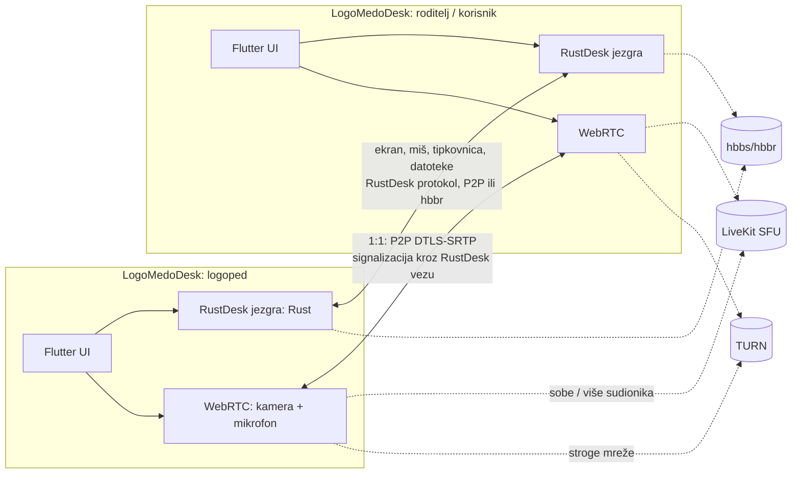

# Arhitektura

## Ideja

RustDesk je alat za udaljeno upravljanje, a ne za sastanke. Ima vlastiti protokol (protobuf preko TCP/UDP, NAT traversal kroz
hbbs, relay hbbr) i kodeke za oštar tekst i malo kašnjenje unosa. Zvuk koji prenosi je zvuk sustava, bez poništavanja jeke.
WebRTC rješava obrnuti problem: razgovor (poništavanje jeke, jitter buffer, kontrola zagušenja).

Zato se dva prijenosa **ne miješaju**, nego rade jedan uz drugog u istom Flutter UI-ju:

## Dva načina za medije

1. **1:1, pravi P2P (`flutter_webrtc`).** SDP i ICE kandidati idu kao nova protobuf poruka kroz **već otvorenu RustDesk vezu**.
   Ne treba ni signalizacijski poslužitelj ni soba: poziv postoji dok postoji RustDesk sesija. Za mreže gdje izravna veza ne
   prolazi treba TURN (coturn ili Cloudflare TURN), jer hbbr nije TURN.
2. **LiveKit (`livekit_client`)**, od prvog dana uz P2P. LiveKit je SFU, pa medij ide kroz poslužitelj (enkriptirano, E2EE je
   opcija). Služi za više od dvoje sudionika (logoped, roditelj i dijete na dva uređaja), snimanje uz privolu i mobilne
   klijente. Token za sobu izdaje logomedo.com (Worker), a ne klijent.

Oba načina koriste isti sloj u UI-ju (`MedijSesija`: lokalni i udaljeni video, mute, uređaji), pa se izmjenjuju bez diranja ekrana.

## Zvuk za logopediju

- Poništavanje jeke **uključeno**. Potiskivanje šuma i automatska glasnoća **isključeni** (`noiseSuppression: false`,
  `autoGainControl: false`), jer režu sibilante (s, š, c, z, ž).
- Opus mono, 48 kHz, 64–128 kbps.
- Provjeriti na stvarnim snimkama izgovora prije prve terapije.

## Smjer

- **Podrška:** logoped (ili LogoMedo podrška) gleda i upravlja korisnikovim ekranom; korisnik odobrava klikom.
- **Terapija:** logoped često pokazuje **svoj** ekran (igru) djetetu, a to je obrnut smjer. Može biti obična RustDesk sesija
  u suprotnom smjeru ili dijeljenje ekrana kroz WebRTC/LiveKit. Odluka u planu.

## Poslužitelji (vlastiti)

| Servis | Portovi | Napomena |
|---|---|---|
| hbbs (rendezvous) | TCP 21115, 21116, 21118; UDP 21116 | Cloudflare ih ne proxyja: DNS only |
| hbbr (relay) | TCP 21117, 21119 | |
| LiveKit | TCP 7880 (API/WS), 7881 (ICE/TCP), UDP 50000–60000 ili jedan UDP port | |
| TURN | 3478 UDP/TCP, 5349 TLS | ili Cloudflare TURN |

## GDPR

Terapija djeteta je posebna kategorija podataka (zdravlje). Nema snimanja bez izričite privole roditelja, korisnik uvijek
vidi da je sesija aktivna i može je prekinuti, a sesije se bilježe (tko, kad, trajanje) bez sadržaja.

## Vezani dokumenti

- [plan.md](plan.md): koraci
- [forkovi.md](forkovi.md): forkovi, upstream, verzije
- Istraživanje prije odluke: `logomedo.com/docs/podrska/quick-support-istrazivanje.md`
  ([GitHub](https://github.com/logomedo/logomedo.com/blob/main/docs/podrska/quick-support-istrazivanje.md))
